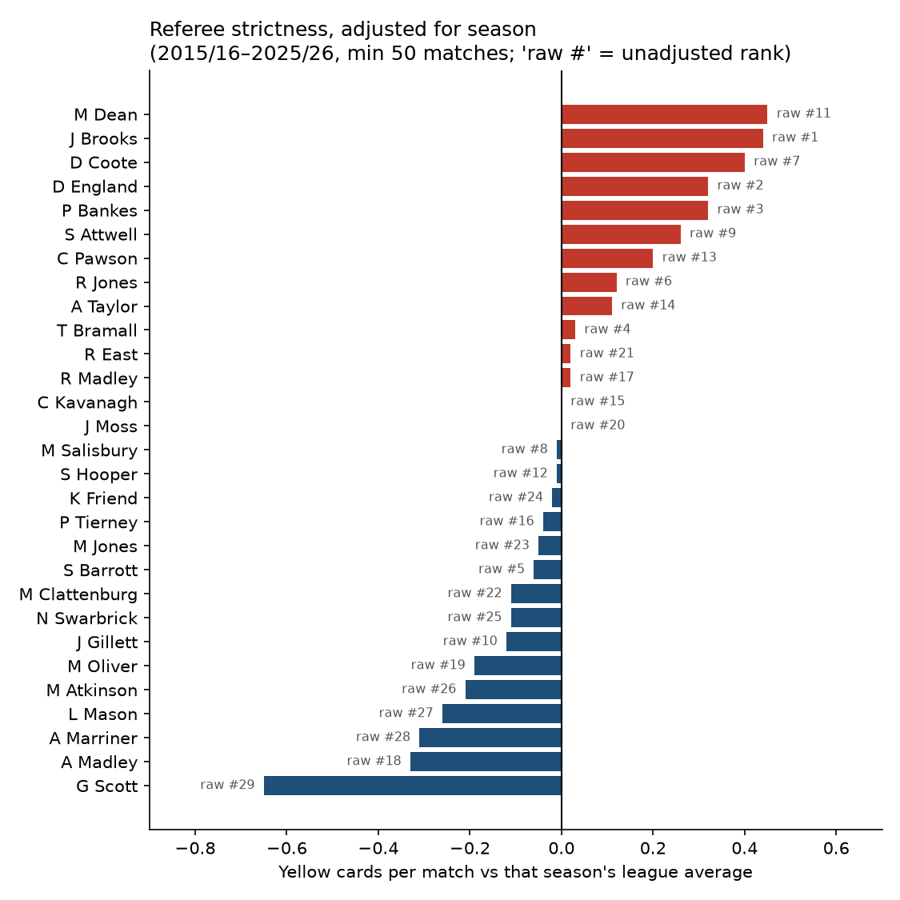
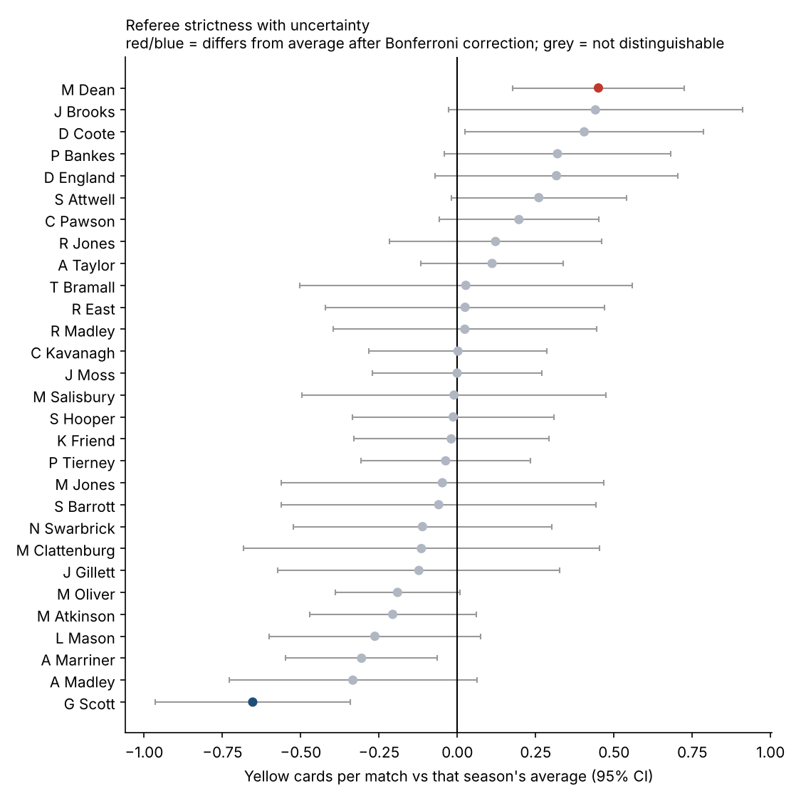
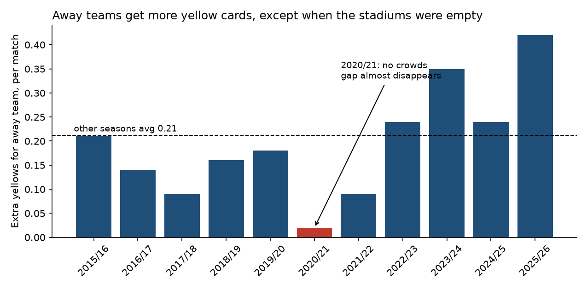

# Premier League Refereeing, 2015/16–2025/26: Three Findings

*4,180 matches, 11 seasons. Referees with at least 50 matches (29 referees) are compared. Data: football-data.co.uk via the open `datasets/football-datasets` repository.*

## 1. Raw card counts mislabel who is "strict": adjust for the season first

League-wide yellow cards jumped from 3.59 per match in 2022/23 to 4.17 in 2023/24, after the clampdown on dissent and time-wasting. Referees who only officiated recently therefore look strict on raw averages. After comparing each match with its own season's average:

- **Mike Dean** moves from 11th to **1st** (+0.45 yellows per match above his season's average).
- **Sam Barrott** falls from 5th to **20th**: his raw number mostly reflects when he refereed.
- **Graham Scott** is the most lenient on both measures (−0.65 per match).

**How reliable is the ranking?** Referees do differ overall (joint F-test with home and away team controls, p < 0.001), and Dean stays 1st after those team controls. But with 29 referees tested at once, only Dean and Scott differ from the average after a Bonferroni correction. Dean's 95% interval (+0.18 to +0.72) overlaps with all of the next four, so the order at the top should not be over-read.

## 2. Away teams get more yellow cards, but this gap nearly vanished without crowds

In normal seasons the away side receives **0.21 more yellows per match** than the home side (95% CI 0.16 to 0.26, p < 0.001), and 25 of 29 referees show this pattern. In 2020/21, played behind closed doors, the gap fell to **0.02** (95% CI −0.13 to 0.18, not distinguishable from zero), and the home win rate dropped from 45% to 38%. The fall is statistically significant (Welch t-test, p = 0.025).

## 3. The crowd effect seems to work through teams, not only referees

Without crowds, away teams committed *fewer* fouls than home teams (10.55 vs 11.22 per match, against 10.96 vs 10.48 normally). Cards **per foul** still favoured home teams in 2020/21 (0.127 home vs 0.137 away). So most of the closing gap came from how teams played, not from referees judging fouls differently.

A regression confirms this (one row per team per match, team and season fixed effects, standard errors clustered by match). Without crowds, the extra yellows for away teams fell by 0.19 (p = 0.022). Once fouls committed are added as a control, that change shrinks to 0.04 and is no longer significant (p = 0.64): roughly four-fifths of the no-crowd effect runs through fouls. In normal seasons away teams still receive 0.15 more yellows for the same number of fouls (p < 0.001), so a smaller referee-side effect remains. Full tables: [`outputs/stats_results.md`](outputs/stats_results.md).

## Caveats

- The tests treat matches as independent within a referee; repeated fixtures and referee-team pairings mean the true uncertainty may be a little larger.
- This is correlation from one natural experiment (a single no-crowd season), not proof of referee bias.
- Referees are not randomly assigned to matches: high-stakes or derby games may go to particular referees.
- VAR (from 2019/20) and rule changes alter card counts over time; the season adjustment handles league-wide shifts only.

## Recommendation

When judging a referee, a club analyst or media team should use **season-adjusted, fouls-adjusted** measures rather than raw cards per match, and should treat home/away gaps as partly a team-behaviour effect.
